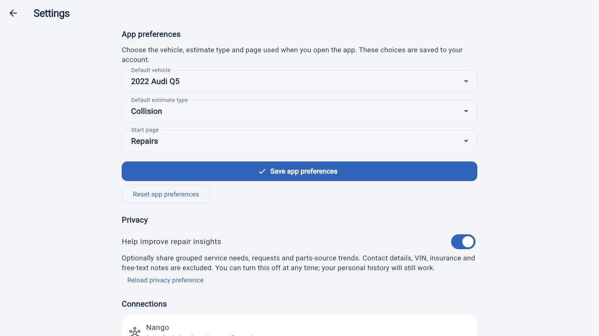

# Customer settings and feature hardening — October 17, 2026

This pass completes CRUD for customer contact details and app preferences across
the Flutter app, FastAPI service and explicit demo. It does not add account
deletion or sign-in email migration.

## User behavior

- Profile name, phone, service ZIP and contact preference can be read, saved,
  discarded or cleared. Clearing requires confirmation and preserves account
  identity, vehicles, estimates and history. Information already sent to shops
  is not recalled. Name and ZIP are optional here; service request prerequisites
  remain enforced at submission. Phone contact requires a valid phone number.
- Default vehicle, PDR/Collision estimate type and starting page are saved to the
  account. Reset returns these preferences to defaults. Defaults apply on initial
  load and after an explicit preference save/reset, while ordinary background
  refreshes preserve current navigation. Deleting an otherwise unused default
  vehicle clears the preference atomically.
- Dirty forms keep drafts when server data changes and offer discard/reload.
  Conflicting writes cannot silently overwrite a newer revision. Duplicate saves,
  delayed responses and confirmation callbacks are bound to the current account.
- Privacy uses the same aggregate-insights consent as service history. Failed or
  malformed reads do not imply consent is off. An uncertain save preserves its
  intended choice and offers retry or canonical reload.
- Sign-out has confirmation in both entry points. Session invalidation drops
  private in-memory snapshots and conversation state immediately. Durable pending
  request recovery remains scoped to the original account.
- Pending sign-out operations retain their initiating controller and identity.
  An old completion, error or captured callback cannot clear or report errors on
  a newer account; repeated exits for the same controller are deduplicated.

## Persistence and concurrency

Profile and app preferences have independent revisions. The new app supplies
the expected revision for every write/reset; the server serializes competing
writes with the existing customer lock and returns a safe 409 conflict code.
Legacy profile PUT requests without a revision remain supported; these older
clients cannot receive the same stale-edit protection.

Reset retains a revision record instead of returning to revision zero. A stale
editor therefore cannot recreate the pre-reset state. Partial profile writes
preserve omitted fields; explicit empty strings clear optional details.

The controller applies acknowledged responses without requiring bootstrap to
succeed. Refreshes requested during settings writes coalesce and run afterward;
older bootstrap revisions cannot replace acknowledged settings. Demo validation,
conflicts and reset behavior match these contracts.

## Validation

- `cd app && flutter analyze --no-pub`: no issues.
- `cd app && flutter test --no-pub --reporter expanded`: **397 passed**.
  Coverage includes settings lifecycle, dirty drafts, canonical privacy failures,
  expired sessions, late sign-out completion, duplicate callbacks and 320px
  enlarged-text layouts. Existing session tests now assert private data is cleared
  while retaining their late-upload and callback protections.
- `cd app && flutter build web --no-pub --dart-define=PLUS_DEMO=true`: passed.
  This is the JavaScript build; the existing secure-storage Wasm compatibility
  warning remains and no Wasm release is claimed.
- Full backend suite with disposable PostgreSQL 15: **517 passed, 7 skipped**.
  The skipped tests require the separate original-Estimoto contract environment.
  Migration upgrade/downgrade, RLS and inherited-privilege revocation, customer
  isolation, simultaneous profile/settings saves and reset replay passed.
- `backend/.venv/bin/python scripts/smoke_api.py --flutter-client`: passed with
  real local HTTP requests from Python and the Dart API adapter. It verifies
  profile/settings/privacy CRUD, conflicts and isolation, schema parity, and
  saved/reset state across API restarts. Provider credentials are excluded from
  this harness; disposable services and storage are cleaned up afterward.
- Local browser smoke exercised profile save, app defaults save/reopen, applying
  the Repairs start page, privacy enable/withdraw, preference reset and profile
  clear with identity preserved. This is fictional demo behavior; durable API
  persistence is verified separately by the socket smoke above.
- Independent review caught dropped refreshes during settings saves and an old
  sign-out completion clearing a newer account. Both now have regression tests.

## Release boundary

Migration **e2f714a09bc3** adds the private preferences table and profile revision.
Apply `alembic upgrade head` before starting the updated backend, then release
the app; readiness now requires this schema revision. Do not roll out the new
settings client against the previous backend routes.

This record covers source, local tests and a fictional demo preview. No production
deployment, native store distribution, physical-device check or provider contact
is claimed. Calendar/Gmail remain unconfigured. CARFAX, push reminders and
automated phone/SMS booking remain separate integration work.
